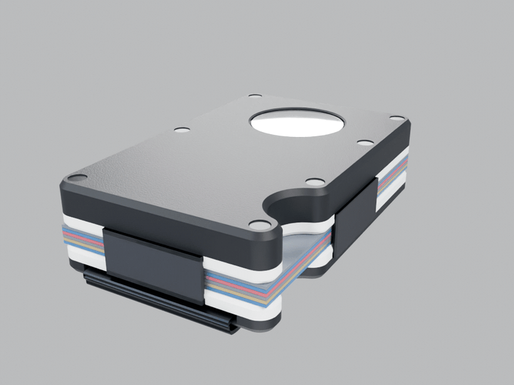
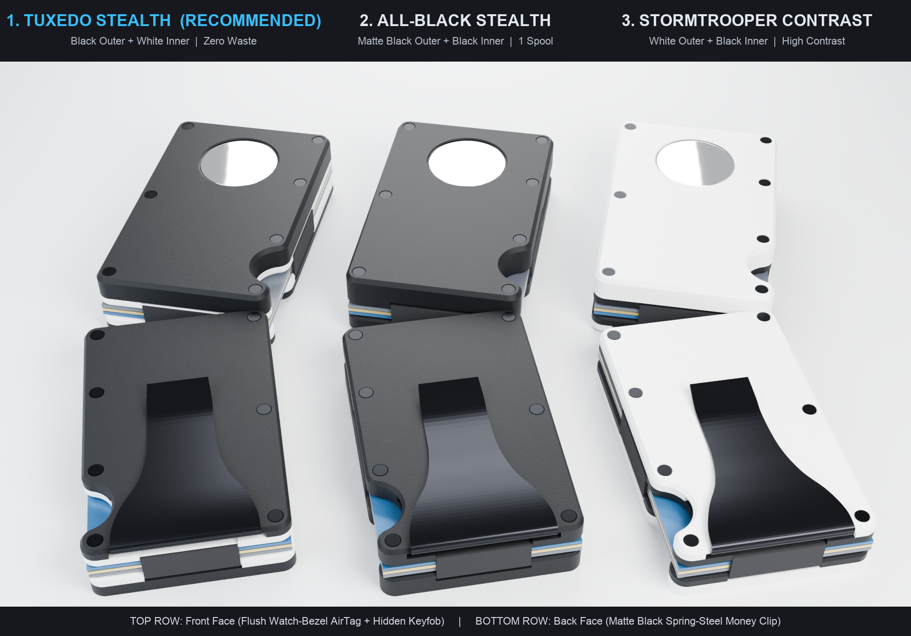
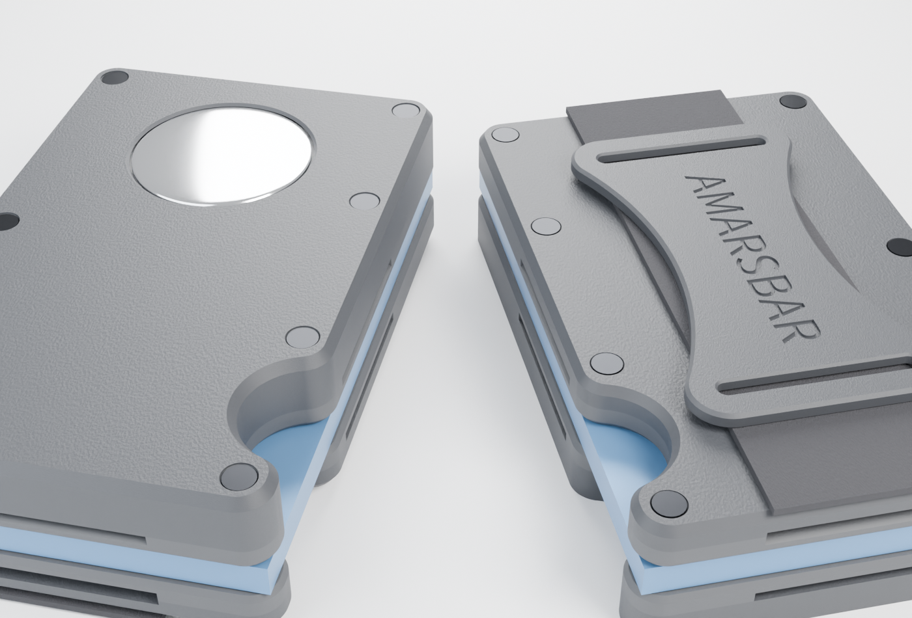
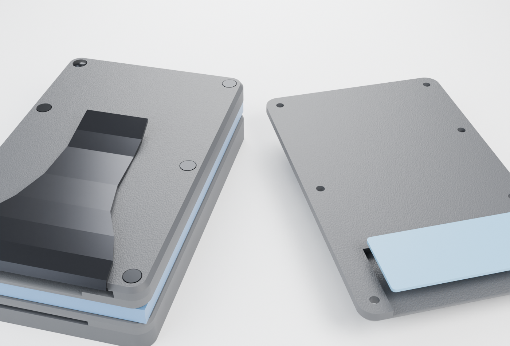
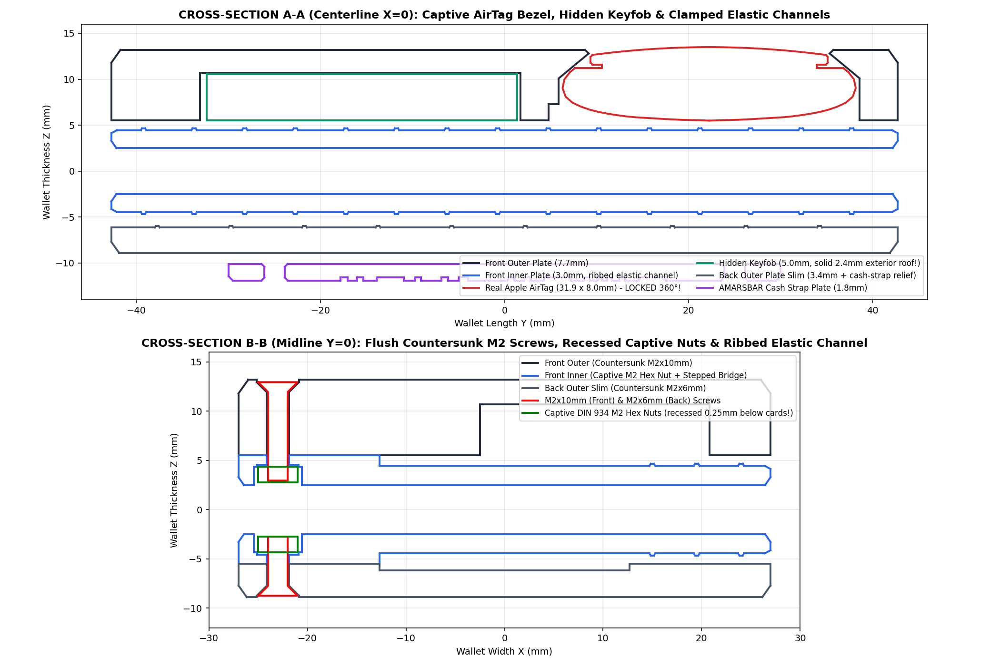

# Ridge-Style 3D Printable AirTag + Keyfob Wallet

A parametric, 100% support-free, Bambu Lab–ready redesign of a Ridge-style minimalist card wallet engineered in **CadQuery (Python)** with:
- **Zero-pop-out watch-style captive Apple AirTag mount** (360° mechanical retention lip, dead-flush stainless steel cap)
- **100% hidden internal RFID keyfob cavity** beneath a continuous solid `2.50 mm` matte exterior face
- **Ribbed, clamped 3-sided elastic T-channel** (holds **1–12 cards** with zero elastic slip or fraying)
- **Dead-flush M2 countersunk screws + recessed captive M2 hex nuts** (Voron stepped double-bridges, no soldering iron required)
- **Interchangeable back plates**: either a **3D-printed compliant print-on-side PETG leaf-spring money clip** (with positive pull-out locking keyway) or a thickened **chamfered `AMARSBAR` elastic cash strap**
- **1-Plate, 2-Color AMS `By Object` Bambu Lab P1S `.3mf`** (only **1 single filament swap**, zero prime tower, zero purge waste!)

---

## 360° Exploded-View Assembly Animation

<p align="center">
  
</p>

> Full HD 24 fps MP4 video: [`redesigned_wallet/previews/05_Ridge_Wallet_Exploded_Animation.mp4`](redesigned_wallet/previews/05_Ridge_Wallet_Exploded_Animation.mp4)

---

## Black & White Colorways (Zero-Waste AMS / Two-Color Options)

<p align="center">
  
</p>

**Recommended Colorway — Tuxedo Stealth:**
- **Matte Black Outer Plates** (`02_Front_Outer`, `04B_Back_Outer_MoneyClip`, `07_Printed_PETG_Money_Clip`) — stays clean in pockets and frames the polished stainless steel AirTag like a diver's watch bezel.
- **Crisp White Inner Plates** (`01_Front_Inner`, `03_Back_Inner`) — adds a razor-sharp architectural white pinstripe around the perimeter and inside the thumb notch with **zero AMS purge waste**.

---

## Studio Renders & Mechanical Cross-Section Verification

| Front & Back Cash Strap Edition | Money Clip Back Plate & Locking Pocket |
| :---: | :---: |
|  |  |

<p align="center">
  
</p>

Every mating surface, scaled Apple AirTag (`31.90 × 8.00 mm`), keyfob (`23.56 × 49.05 × 5.00 mm`), and print-on-side PETG spring money clip passes automated 3D boolean interference verification with **`0.0000 mm³`** overlap.

---

## Engineering Highlights

| Feature | Specification |
|---|---|
| **Overall Footprint** | `54.0 × 85.5 mm` (exact ISO/IEC 7810 ID-1 card silhouette) |
| **Card Capacity** | **1–12 standard credit/debit/ID cards** (up to ~14 flat cards) + **5–15 folded bills** |
| **Captive AirTag Chamber** | `Ø 32.70 mm` internal cavity → support-free cone → `Ø 26.20 mm` chamfered watch bezel (`2.85 mm` 360° retaining lip; internal 6-o'clock pry notch for annual battery changes) |
| **Hidden Keyfob Pocket** | Blind `5.20 mm` cavity inside lower front plate under a continuous `2.50 mm` solid exterior wall (`>= 3.67 mm` wall clearance to all edges, screws, and AirTag) |
| **Clamped Elastic T-Channel** | `25.4 mm` wide × `1.05 mm` deep with `0.22 mm` transverse anti-slip grip ribs and chamfered exits |
| **Flush M2 Fasteners** | 7× `M2 × 10 mm` (front) + 7× `M2 × 6 mm` (back) 90° flat-head countersunk black screws into 14× captive DIN 934 M2 hex nuts recessed `0.25 mm` below the card face |
| **3D-Printed PETG Money Clip** | `24.0 mm` wide tapered leaf-spring printed **on its side** (100% continuous perimeter fibers around the C-arch, `< 0.75%` max bending strain at 5 mm lift, positive `0.67 mm` pull-out locking tooth inside `04B`'s transverse keyway) |

---

## Repository Structure

```text
.
├── redesigned_wallet/
│   ├── build_ridge_wallet.py                 # Editable parametric CadQuery source (rebuilds all STEP/STL)
│   ├── BUILD_GUIDE_AND_BOM.md                # Full build notes, slicing guide & BOM
│   ├── STEP/                                 # Lossless NURBS CAD files (01–07, pre-oriented at Z=0)
│   ├── STL/                                  # High-res watertight meshes (01–07, pre-oriented at Z=0)
│   ├── previews/                             # Blender Cycles studio renders, cross-sections, MP4 & GIF
│   ├── sliced_for_bambu_P1S/                 # Pre-sliced Bambu Studio P1S (.3mf + 0.12 mm presets)
│   │   ├── ONE_PLATE_AMS_Tuxedo_PrintedMoneyClip_SLICED_P1S_BambuPETGBasic.3mf  # ★ 1-plate AMS By-Object!
│   │   ├── ONE_PLATE_AMS_Tuxedo_MoneyClip_SLICED_P1S_BambuPETGBasic.3mf         # 1-plate AMS (metal clip)
│   │   ├── Plate1_BLACK_OuterPlates_SLICED_P1S_PETG.3mf
│   │   ├── Plate2_WHITE_InnerPlates_SLICED_P1S_PETG.3mf
│   │   └── AllInOne_MoneyClip_Wallet_SLICED_P1S_PETG.3mf
│   ├── Ridge_Wallet_Full_Assembly_Reference.step
│   ├── Ridge_Wallet_MoneyClip_Edition_BambuReady.3mf
│   ├── Ridge_Wallet_ALL_5_PARTS_BambuReady.3mf
│   └── Ridge_Wallet_COMPLETE_CashStrap_and_MoneyClip_BambuReady.3mf
└── original_files/                           # Archived original Onshape ZIPs & STEP exports
```

---

## Ready-to-Print Bambu Lab P1S Slicing Settings

Open [`ONE_PLATE_AMS_Tuxedo_PrintedMoneyClip_SLICED_P1S_BambuPETGBasic.3mf`](redesigned_wallet/sliced_for_bambu_P1S/ONE_PLATE_AMS_Tuxedo_PrintedMoneyClip_SLICED_P1S_BambuPETGBasic.3mf) directly in **Bambu Studio**:
- **Printer & Bed:** Bambu Lab P1S · `0.4 mm` Hardened Steel Nozzle · **Textured PEI Plate** (`70 °C`)
- **Filament:** Official `Bambu PETG Basic @BBL X1C` (`255 °C` / `245 °C` first layer)
- **Print Sequence:** `By Object` — prints White inner plates first, crosses a `92 mm` gantry clearance gap, performs **1 single AMS swap (`White → Black`)** with no prime tower, and prints Black outer plates + side-standing PETG spring money clip
- **Finish Settings:** `0.12 mm` layers (`0.20 mm` first layer) · **Arachne** · **4 walls** · **7 top/bottom shells** · **40% Gyroid** · `inner-outer-inner` wall order · **55 mm/s** satin outer walls · **35 mm/s** first layer · `0.12 mm` elephant foot comp · Arc Fitting ON · **0 supports**
- **Verified Totals:** **4h 12m** · **63.6 g** total

---

## Bill of Materials (Amazon Canada)

| Item | Link | Notes |
|---|---|---|
| **Black Pre-Sewn Ridge Card Elastic Band Kit** | [Moibunka 25-Pcs Black Replacement Elastic Kit](https://www.amazon.ca/dp/B0GQQN46XJ) | Dark black stretch T-band (doesn't show dirt, zero sewing) |
| **Black M2 Countersunk Screws + M2 Hex Nuts + Wrench** | [HanTof 900-Pcs Black Grade 10.9 DIN7991 Flat-Head M2/M2.5/M3 Kit](https://www.amazon.ca/dp/B0FF4TVQ7G) | Includes `M2×6 mm` (back), `M2×10 mm` (front), `M2` hex nuts, and matching hex key |
| *(Optional)* **Matte Black Forged Spring-Steel Money Clip** | [MINBERAND Ridge Money Clip & Cash Strap Kit](https://www.amazon.ca/dp/B0HJV2V9D5) | Optional metal upgrade if swapping from the 3D-printed PETG leaf-spring clip |
| *(Optional)* **Matte Carbon-Fiber Filament** | [FLASHFORGE PETG-CF 1.75 mm Black 1 kg](https://www.amazon.ca/dp/B0D7VXC38N) | Requires hardened steel nozzle; confirmed RFID & AirTag transparent |

---

## Rebuilding CAD from Source

```bash
pip install cadquery trimesh numpy
python3 redesigned_wallet/build_ridge_wallet.py
```

All parts are automatically checked for `0.0000 mm³` interference and re-exported pre-oriented flat at `Z = 0` into `redesigned_wallet/STEP/` and `redesigned_wallet/STL/`.
